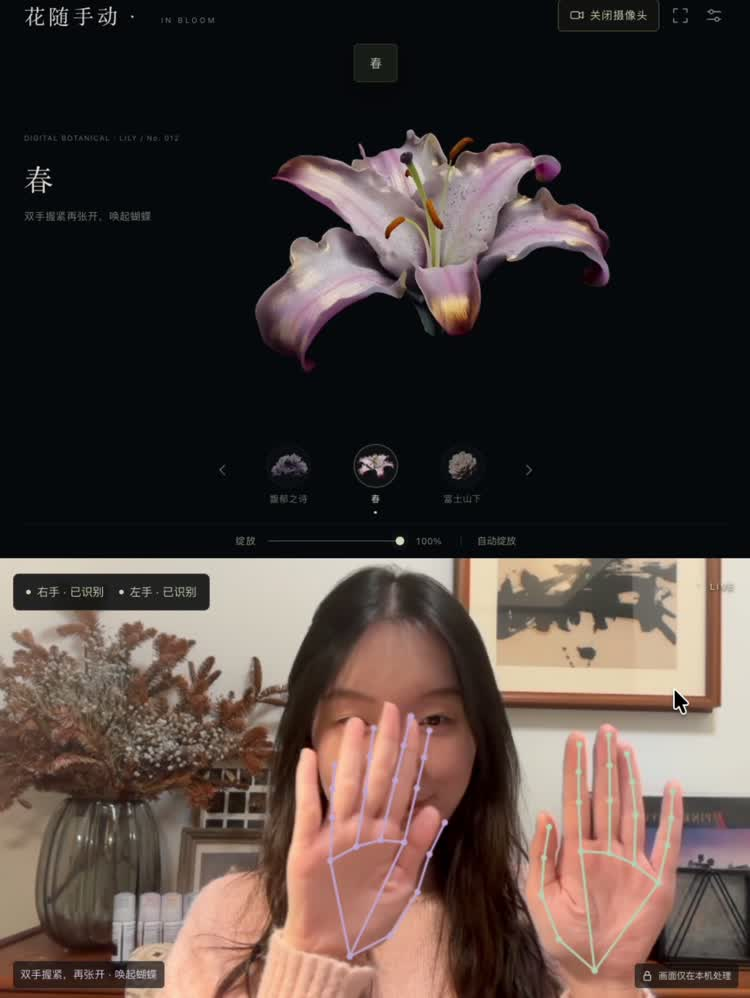

# 花随手动 · In Bloom

浏览器内的数字花卉手势交互。三组源素材已分离为透明画面，居中呈现在统一近黑背景 `#08090b` 上。原始 MP4 不做修改。

## 演示视频

[观看短版演示](docs/demo.mp4) · [下载高清原片](https://github.com/juliettesfriday/flower-in-your-hands/releases/tag/v1.0.0)

## 运行

安装 Node.js 20 或更新版本后，在本目录运行 `npm start`，打开 `http://127.0.0.1:8786`。网页需通过 localhost 或 HTTPS 打开，不能直接双击 HTML 使用摄像头。无需 npm install，手势模型、WASM 和动画帧都在项目内。

1. 点击“开启摄像头”，允许浏览器的摄像头权限。
2. 右手掌心对镜头，张开手指到握拳，连续控制花朵展开程度。
3. 左手张开，稍停稳后向左右横推，切换前后花朵；每次推移只切换一次，停稳后可再次切换。
4. 双手同时握紧，稍停约 0.15 秒后迅速同时张开，触发 96 只蝴蝶从双手附近飞散，覆盖整块 3:4 画面。约 7 秒后消散；再次触发需冷却结束并重新握紧。设置里的“预览蝴蝶”可直接查看效果。
5. 如果左右手识别相反，右上角设置中勾选“交换左右手”。

可用底部滑杆、花朵按钮、左右方向键和“自动绽放”体验。空格启动或暂停演示。关闭摄像头、离开页面或切到后台时会释放摄像头。只请求视频，不请求麦克风；视频画面及手部关键点不发送到服务器。

## 素材状态

- **春**（原名：百合）：原片包含完整花苞至盛开，可以可逆控制。
- **馥郁之诗**（原名：馥郁）：原片从头到尾都是盛开状态；目前控制原有花瓣舒展与旋转，不能闭合成花苞。原片底部裁切已柔化。补齐真实闭合状态需要另外的动画源或通过 Veo 生成合格片段，见 `VEO制作说明.md`。
- **富士山下**（原名：花绽时流）：提取中心花体并跟踪居中，保留原片的展开过程；原片拖尾已压低，中间状态仍有柔边和少量姿态变化。

素材来自用户提供的「致奇」数字花卉视频；各组 96 张 640×640 透明 WebP。来源及授权范围见 [THIRD_PARTY_NOTICES.md](THIRD_PARTY_NOTICES.md)。

## 检查

`npm test`：23 项手势算法与摄像头生命周期测试，覆盖开合、左右手、抖动/垂直移动、推移防重复、丢失跟踪、关闭与权限失败资源清理，以及取消启动与演示模式之间的竞态。双手释放测试覆盖快速同步打开、单手、慢动作、错开时间、短暂抖动、追踪中断、冷却与切花互斥。

浏览器检查覆盖三花切换、花苞/盛开端点、自动演示、左右手设置和资源加载。已在 Chrome 成功加载本地 GPU 模型并对空白画面完成推理，识别到 0 只手；该检查不打开摄像头。真实双手识别仍需本人在摄像头前验证，不能用算法单测代替实际体验。

## 依赖与结构

- MediaPipe Tasks Vision **0.10.21**，本地加载在 `public/vendor/mediapipe/`。
- 官方 hand_landmarker float16/1 模型，位于 `public/models/`。
- 手势逻辑 `public/gesture-engine.js`；渲染与交互 `public/app.js`；本地蝴蝶叠层 `public/butterflies.js`（支持减少动态效果偏好）。
- 素材索引 `public/media/manifest.json`。`npm run build` 将 `public/` 复制到 `dist/`，后者为发布目录。
- 帧缓存仅保留约一组完整解码画面；切花时淘汰旧组，避免同时常驻三组完整帧。

官方接口参考：https://ai.google.dev/edge/mediapipe/solutions/vision/hand_landmarker/web_js

## 开源许可

本项目原创代码采用 [MIT License](LICENSE)。MediaPipe 依赖遵循其 Apache-2.0 许可。花卉图像、演示视频及其中音乐不属于 MIT 授权范围，其权利归各自权利人；重新使用前请自行取得相应授权。
